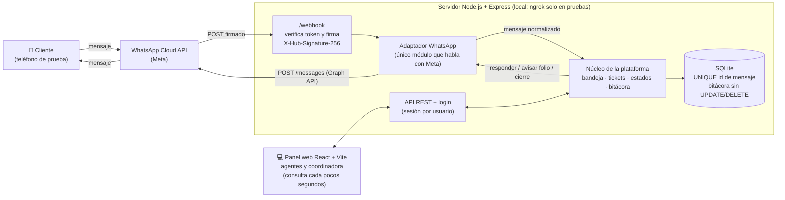

# CU-BKN-01 · Diagrama de arquitectura

## Piezas
- **Webhook:** recibe de Meta; rechaza (401) lo que no trae firma válida; responde 200 rápido.
- **Adaptador WhatsApp:** traduce entre el formato de Meta y el formato interno. Es el **único** archivo que conoce Meta; para cambiar de proveedor se escribe otro adaptador sin tocar el núcleo.
- **Núcleo:** reglas del negocio: conversaciones, asignación, tickets con folio, tabla de transiciones y bitácora.
- **SQLite:** un archivo local, sin instalar servidor de base de datos (otra persona lo levanta en minutos).
- **Panel web:** bandeja compartida, seguimiento de tickets y detalle con bitácora.
- **Secretos:** token, app secret y verify token solo en `.env` (ignorado por Git).
