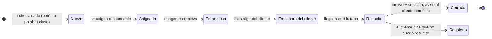

# CU-BKN-01 · Diagrama de estados del ticket

## Tabla de transiciones permitidas

| Desde | Hacia | Condición |
|---|---|---|
| Nuevo | Asignado | Tener responsable |
| Asignado | En proceso | — |
| En proceso | En espera del cliente | — |
| En espera del cliente | Resuelto | — |
| Resuelto | Cerrado | Motivo y solución obligatorios; se avisa al cliente con su folio |
| Resuelto | Reabierto | El cliente responde que no quedó resuelto; vuelve a la bandeja |

**Cualquier otro salto se rechaza** (por ejemplo, Nuevo → Cerrado). Esta tabla vivirá en un solo archivo del código y tendrá su prueba automatizada.

**Reasignar responsable no cambia el estado**; solo se registra en la bitácora (quién, cuándo, responsable anterior y nuevo).

## Pendiente de decidir (no se agrega sin autorización)
- ¿**Reabierto → En proceso**? Sin esta transición, un ticket reabierto no puede volver a trabajarse.
- ¿**En espera del cliente → En proceso**? (el cliente respondió, pero aún falta trabajo).
- ¿**En proceso → Resuelto** directo? (casos que no requieren nada del cliente).
