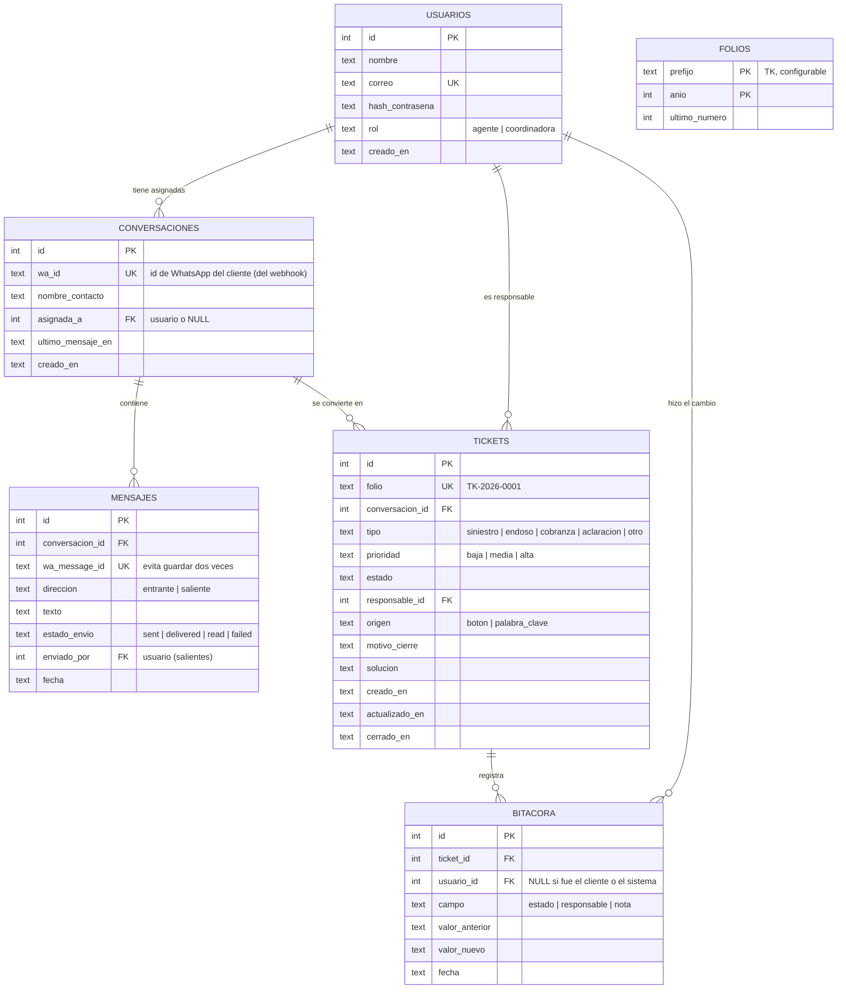

# CU-BKN-01 · Modelo de datos (SQLite)

## Reglas en la base de datos
- `MENSAJES.wa_message_id` **UNIQUE**: si Meta reenvía el mismo mensaje, no se guarda dos veces (criterio 3).
- `BITACORA` **solo se inserta**: triggers que rechazan `UPDATE` y `DELETE` (criterio 8). La API no tendrá endpoints para editarla ni borrarla.
- `TICKETS.folio` **UNIQUE**; el consecutivo sale de `FOLIOS` dentro de una transacción, con prefijo configurable (`TK-2026-0001`).
- `CONVERSACIONES.wa_id` guarda el identificador que entrega el webhook; las respuestas siempre se mandan a ese valor (evita el problema 52/521 de México).
- Contraseñas guardadas como hash, nunca en texto.
